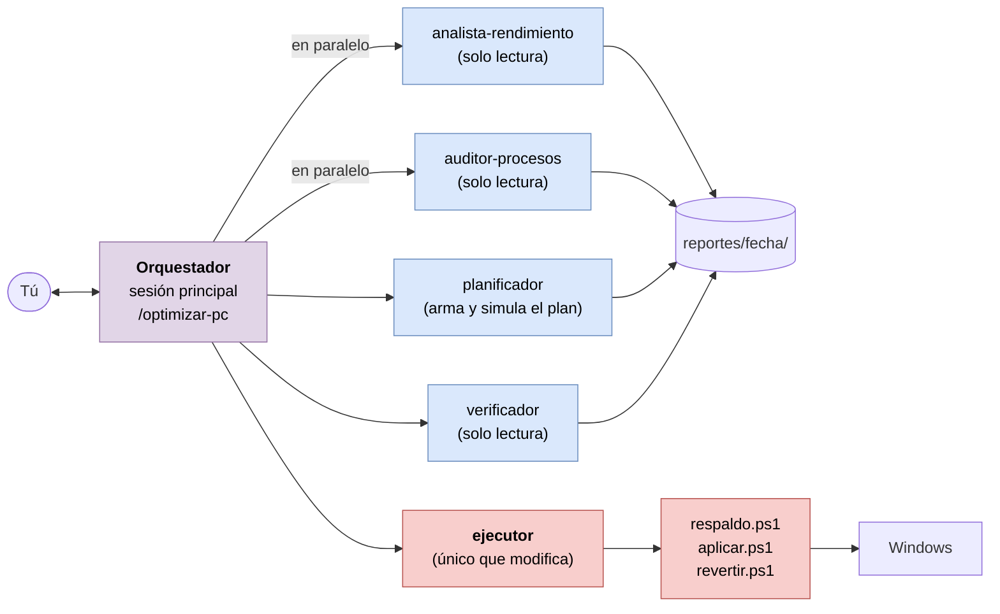

# Plan maestro: optimizar el PC con un equipo de agentes de Claude Code

Este documento explica **qué va a hacer Claude en tu PC, en qué orden, con qué agentes y con qué garantías**. Las instrucciones que Claude sigue de verdad están en `.claude/skills/optimizar-pc/SKILL.md` y en `.claude/agents/`. Este plan es la versión para leer.

- **Objetivo:** sacar el máximo rendimiento a un PC con recursos limitados para **jugar y navegar**, quitando lo que corre en segundo plano sin aportar nada (procesos ocultos o innecesarios) y corrigiendo configuraciones que frenan el equipo.
- **Supuestos:** Windows 10 u 11, Claude Code ya instalado, y una cuenta de administrador en el PC.
- **Principio:** nada se cambia sin que lo apruebes, todo queda respaldado y casi todo se puede deshacer con un comando.

---

## 1. Cómo usarlo (5 pasos)

1. **Descarga el repositorio** en tu PC, por ejemplo en `C:\pc-optimization`:
   `git clone https://github.com/joseerzj-lab/pc-optimization.git C:\pc-optimization`
   (o descárgalo como ZIP desde GitHub y descomprímelo).
2. **Abre la Terminal como administrador**: clic derecho en Inicio (o Win+X) > *Terminal (Administrador)*.
3. Entra en la carpeta y abre Claude Code:
   ```
   cd C:\pc-optimization
   claude
   ```
4. Escribe **`/optimizar-pc`** y responde las preguntas. Claude te avisa en cada punto de decisión.
5. Cuando Claude te pida **reiniciar**, reinicia. Después abre otra vez la Terminal como administrador, entra en la carpeta y escribe **`claude --continue`** para que retome la verificación.

> Claude Code te pedirá permiso antes de cada comando. Es una capa más de seguridad: lee qué va a ejecutar y aprueba. Para los scripts del repositorio puedes elegir la opción de no volver a preguntar durante la sesión.

---

## 2. Arquitectura: un orquestador y cinco agentes

En vez de un solo Claude que lo hace todo, el trabajo se reparte entre **subagentes especializados**. Cada uno tiene su propio contexto, sus herramientas y una sola responsabilidad.



| Agente | Qué hace | ¿Modifica el sistema? | Entrega |
|---|---|---|---|
| **Orquestador** (sesión principal) | Habla contigo, te hace las preguntas, decide el siguiente paso, delega y pide tu aprobación | No directamente | `estado.md`, `informe.md` |
| **analista-rendimiento** | Busca el cuello de botella: CPU, RAM (y si está en canal simple), disco, GPU, energía, red, temperatura, estabilidad | No | `analisis-rendimiento.md` |
| **auditor-procesos** | Clasifica cada proceso, programa de inicio, servicio, tarea programada y app: esencial, útil, prescindible al inicio, bloatware o sospechoso | No | `auditoria-procesos.md`, `candidatos.json` |
| **planificador** | Convierte los hallazgos en un plan usando solo acciones del catálogo, y lo simula sin tocar nada | No | `plan.json`, `plan.md`, `simulacion.json` |
| **ejecutor** | Crea el respaldo, aplica el plan aprobado y revierte si hace falta, **solo con los scripts** | **Sí, el único** | `respaldo.json`, `cambios.json` |
| **verificador** | Mide otra vez, compara antes y después, y si algo falla encuentra qué cambio lo causó | No | `comparacion.md`, `verificacion.md` |

**Por qué este diseño:**

- **Separación de funciones.** Los agentes que analizan no pueden cambiar nada. El único que cambia algo no decide qué cambiar: ejecuta un plan que tú aprobaste.
- **Paralelismo donde se puede.** El análisis de rendimiento y la auditoría de procesos son independientes y corren a la vez. El resto va en secuencia porque cada paso depende del anterior y de tu aprobación.
- **Contexto limpio.** Cada subagente lee solo lo que necesita y devuelve un resumen corto. La conversación principal no se llena de datos crudos.
- **Determinismo.** Los cambios no son comandos improvisados: los aplican scripts probados que guardan el estado previo de cada elemento.

Cómo se despliegan: Claude Code carga automáticamente los agentes de `.claude/agents/` y la skill de `.claude/skills/` al abrirse en la carpeta del repositorio. No hay que instalar nada más. También puedes llamar a un agente suelto, por ejemplo: *"usa el agente auditor-procesos sobre el último diagnóstico"*.

---

## 3. Las 8 fases

El detalle con diagramas BPMN está en [`docs/FLUJO.md`](docs/FLUJO.md).

| Fase | Qué hace Claude | Qué haces tú | Resultado | Punto de decisión |
|---|---|---|---|---|
| **1. Preparar** | Verifica Windows y permisos de administrador; te explica el proceso | Respondes 4 preguntas (uso, perfil, tipo de equipo, qué usas) y dices tus juegos y navegador | `estado.md` | ¿Se cumplen los requisitos? |
| **2. Diagnosticar y auditar** | Diagnóstico de solo lectura; analista y auditor trabajan en paralelo | Cierras juegos y navegador; dices si reconoces los elementos sospechosos | `diagnostico-antes.json`, análisis, auditoría | ¿Hay una amenaza sin resolver? |
| **3. Planificar** | El planificador arma el plan y lo simula | Revisas el plan: apruebas, quitas acciones, pides cambios o cancelas | `plan.json`, `plan.md` | ¿Apruebas el plan? |
| **4. Respaldar** | Punto de restauración y copia del estado de servicios, energía y registro | Nada (o decides si seguir sin punto de restauración) | `respaldo.json`, carpeta `respaldo/` | ¿El respaldo está listo? |
| **5. Aplicar** | El ejecutor aplica el plan paso a paso y registra el estado previo de cada cambio | Haces los pasos manuales guiados y reinicias | `cambios.json` | — |
| **6. Verificar** | Mide otra vez y compara antes y después | Pruebas tus juegos, el navegador, el audio, la red y los periféricos | `comparacion.md`, `verificacion.md` | ¿Todo funciona bien? |
| **7. Cerrar** | Informe final con recomendaciones de hardware, de juegos y de mantenimiento | Lo lees | `informe.md` | — |
| **8. Revertir** (si hace falta) | Deshace todos los cambios registrados; si no basta, te guía con la restauración del sistema | Confirmas y reinicias | `cambios.json` marcado como revertido | — |

Todo queda en `reportes/<fecha-hora>/` en tu PC. Esa carpeta está excluida de git para que no subas datos de tu equipo por error.

---

## 4. Qué revisa (diagnóstico de solo lectura)

| Área | Qué mira |
|---|---|
| Hardware | CPU (núcleos e hilos), RAM total, cuántos módulos y ranuras (canal simple o doble), velocidad configurada frente a la nominal, GPU, fecha del driver, resolución y Hz del monitor |
| Discos | SSD o HDD en la unidad del sistema, salud, espacio libre de cada unidad |
| Uso en reposo | CPU, RAM, disco ocupado, memoria comprometida, paginación, número de procesos |
| Arranque | Tiempo de arranque que registra Windows y qué apps o drivers lo retrasan |
| Procesos | Los que más CPU y RAM consumen, agrupados (por ejemplo, el total de todas las pestañas del navegador) y los que corren fuera de `C:\Windows` |
| **Procesos ocultos o sospechosos** | Nombres de sistema en rutas falsas (un `svchost.exe` fuera de `C:\Windows`), PowerShell oculto u ofuscado, ejecutables sin firma en carpetas de usuario, tareas programadas que ejecutan desde `AppData` o `Temp` |
| Inicio | Todo lo que arranca con Windows (registro y carpetas de inicio), con firma digital y estado |
| Servicios | Los automáticos en ejecución y los de terceros, con su firma |
| Tareas programadas | Las de terceros (actualizadores, telemetría de fabricantes) |
| Aplicaciones | Programas instalados y apps de la Store preinstaladas |
| Seguridad | Estado de Defender, antivirus duplicados, amenazas detectadas, firewall |
| Ajustes de juego | Plan de energía, Modo de juego, grabación de Game Bar, HAGS, efectos visuales, transparencias, archivo de paginación |
| Navegador | Directivas de Edge y Chrome (arranque acelerado, segundo plano) |
| Red | Wi-Fi o cable, latencia y variación (jitter) hacia tu router y hacia internet |
| Estabilidad | Apagados inesperados, errores de hardware (WHEA), pantallazos azules, apps que se cierran solas |

---

## 5. Qué puede cambiar (y qué nunca)

El planificador solo puede elegir acciones del catálogo [`config/catalogo.json`](config/catalogo.json). Cada acción tiene riesgo, condiciones de uso, si se puede deshacer y en qué perfiles entra.

| Categoría | Ejemplos | Riesgo |
|---|---|---|
| Energía | Plan Alto rendimiento; modo "Mejor rendimiento" en portátiles | Bajo |
| Juego | Modo de juego, sin grabación de fondo de Game Bar, frecuencia máxima del monitor, GPU dedicada en portátiles, driver de GPU, HAGS (solo perfil máximo) | Bajo a medio |
| Visual | Efectos visuales en modo rendimiento, sin transparencias | Bajo |
| Navegador | Edge y Chrome sin quedarse en segundo plano; ahorro de memoria; revisar extensiones | Bajo |
| Inicio | Deshabilitar programas que no necesitan arrancar con Windows (igual que el Administrador de tareas, sin desinstalarlos) | Bajo |
| Servicios y tareas | Telemetría; impresión o fax si no los usas; SysMain o búsqueda solo con disco duro mecánico saturado; actualizadores de terceros a Manual | Bajo a medio |
| Bloatware | Quitar apps preinstaladas de la Store que no usas; guía para desinstalar programas sobrantes | Bajo |
| Limpieza | Temporales, caché de actualizaciones, componentes antiguos de Windows Update | Bajo (irreversible) |
| Mantenimiento | Optimizar la unidad (TRIM o desfragmentar), reparar Windows (DISM + SFC), análisis de Defender | Bajo |

**Perfiles:** *Conservador* (solo riesgo bajo), *Equilibrado* (recomendado) y *Máximo* (incluye ajustes de beneficio incierto que se prueban y se revierten si no ayudan).

**Lo que nunca hará** (lo bloquea el propio `aplicar.ps1`, no solo las instrucciones):

- Desactivar Microsoft Defender, el firewall, Windows Update, el Control de cuentas de usuario, la Protección del sistema o el archivo de paginación.
- Tocar servicios críticos (red, audio, licencias, actualizaciones, instalador) ni claves del registro de seguridad.
- Usar "limpiadores de registro", "liberadores de RAM", scripts de *debloat* de internet o ISOs modificadas.
- Cerrar procesos o desinstalar algo sin preguntarte por cada elemento.
- Prometer FPS: se mide antes y después y se informa lo que salió.

---

## 6. Seguridad: cinco capas

1. **Tu aprobación.** El plan se aplica solo si tú dices "sí". El script se niega a ejecutar un plan sin `"aprobado": true`.
2. **Punto de restauración** de Windows antes de cualquier cambio, más una copia del estado de todos los servicios, del plan de energía y de las claves de registro que se pueden tocar.
3. **Registro de cambios reversible.** Antes de tocar cada elemento se guarda su estado previo en `cambios.json`. `revertir.ps1` deshace todo o solo las acciones que elijas.
4. **Lista de protegidos dentro del script.** Aunque un plan pidiera desactivar Defender, `aplicar.ps1` lo bloquea.
5. **Permisos de Claude Code.** Cada comando pide tu permiso, y solo el agente `ejecutor` tiene la tarea de modificar el sistema.

---

## 7. Expectativas honestas

- Optimizar el software **reduce la carga en segundo plano y corrige configuraciones**; no convierte un PC modesto en uno potente.
- Las mejoras más grandes suelen venir de: malware o antivirus duplicados, muchos programas al inicio, plan de energía o frecuencia del monitor mal puestos, RAM en canal simple, drivers muy antiguos y disco casi lleno.
- Si tu límite es físico (disco duro mecánico, 4-8 GB de RAM, GPU antigua), el informe te dirá qué mejora de hardware rinde más por tu dinero.
- En juegos limitados por la GPU, lo que más cambia los FPS son los **ajustes dentro del juego**. El informe final incluye recomendaciones para los juegos que nombres.

---

## 8. Personalizar

- **Gastar menos uso de tu plan:** en cada archivo de `.claude/agents/` puedes cambiar `model: inherit` por `model: sonnet` o `model: haiku`.
- **Añadir una optimización:** agrega una entrada a `acciones` en `config/catalogo.json` con los mismos campos que las demás. Los tipos de paso disponibles son `servicio`, `inicio`, `tarea`, `registro`, `energia`, `limpieza`, `mantenimiento`, `appx` y `manual`.
- **Repetir solo una parte:** `/optimizar-pc verificar` (medir y comparar otra vez) o `/optimizar-pc revertir` (deshacer la última sesión).

---

## 9. Estructura del repositorio

```
pc-optimization/
├── PLAN.md                      ← este documento
├── README.md
├── CLAUDE.md                    ← reglas de oro que cumplen todos los agentes
├── .claude/
│   ├── skills/optimizar-pc/
│   │   ├── SKILL.md             ← orquestador (/optimizar-pc)
│   │   └── criterios.md         ← cómo interpretar el diagnóstico y qué no hacer
│   └── agents/
│       ├── analista-rendimiento.md
│       ├── auditor-procesos.md
│       ├── planificador.md
│       ├── ejecutor.md
│       └── verificador.md
├── scripts/
│   ├── comun.ps1                ← funciones compartidas
│   ├── diagnostico.ps1          ← solo lectura
│   ├── respaldo.ps1
│   ├── aplicar.ps1              ← aplica un plan aprobado (o -Simular)
│   ├── revertir.ps1
│   └── comparar.ps1
├── config/catalogo.json         ← acciones permitidas y elementos protegidos
├── plantillas/plan-ejemplo.json
├── docs/
│   ├── FLUJO.md                 ← diagramas BPMN explicados
│   └── diagramas/               ← flujo-optimizacion.drawio + imágenes
└── reportes/                    ← se crea en tu PC (ignorado por git)
```

---

## 10. Limitaciones conocidas

- **Los scripts aún no se han ejecutado en un Windows real.** Se validaron con el analizador de PowerShell y se probó su lógica (protecciones, catálogo, comparación) fuera de Windows. El propio flujo simula el plan antes de aplicarlo y lo respalda. Aun así, para la primera vez conviene el perfil **Conservador**.
- Las apps de la Microsoft Store que arrancan solas no se detectan automáticamente: Claude te indicará dónde revisarlas (Configuración > Aplicaciones > Inicio).
- La temperatura del hardware no se mide (Windows no la expone de forma fiable). Si el equipo se apaga o baja de rendimiento al jugar, el informe lo señalará como posible causa térmica.
- Los cambios en la BIOS (perfil XMP/EXPO de la RAM, por ejemplo) quedan fuera de este flujo: solo se informan.
