# Flujo del proceso de optimización

Modelo del proceso en **BPMN 2.0**, en dos niveles:

- **L1, visión general**: las 8 fases y sus posibles finales.
- **L2, detalle**: cada fase con carriles (quién hace qué). Las fases 1.0, 7.0 y 8.0 son lineales y se describen en tablas.

Fuente editable: [`diagramas/flujo-optimizacion.drawio`](diagramas/flujo-optimizacion.drawio). Ábrela en [diagrams.net](https://app.diagrams.net) (Archivo > Abrir desde > Dispositivo); cada nivel es una pestaña. Bajo cada imagen hay una versión en Mermaid (texto) que GitHub dibuja directamente.

## Cómo leer los diagramas

| Forma | Significado |
|---|---|
| Óvalo verde | Inicio del proceso (un solo inicio por diagrama) |
| Óvalo rojo de borde grueso | Final: estado terminal del proceso |
| Rectángulo morado | Subproceso: tiene su propio diagrama L2 |
| Rectángulo azul | Tarea de una persona o de un agente de IA |
| Rectángulo gris | Tarea automática: la ejecuta un script de PowerShell |
| Rombo con pregunta | Decisión exclusiva (XOR): se toma una sola rama |
| Rombo con **+** | Paralelo (AND): las ramas corren a la vez y se esperan en el rombo de unión |
| Rombo vacío | Unión de caminos |
| Nota con esquina doblada | Archivo que se genera en `reportes/<fecha>/` |

**Carriles (L2):** *Orquestador* es la sesión principal de Claude Code que sigue `/optimizar-pc` y habla contigo. *Usuario* eres tú. *Subagentes y scripts* son los agentes de `.claude/agents/` y los scripts de `scripts/`. Entre corchetes se indica qué agente hace cada tarea.

## Alcance del proceso

| Elemento | Definición |
|---|---|
| Disparador | El usuario ejecuta `/optimizar-pc` en Claude Code, abierto como administrador en la carpeta del repositorio |
| Entradas | El PC con Windows 10/11, las respuestas del usuario (uso, perfil, qué usa), `config/catalogo.json` |
| Salidas | PC optimizado, `informe.md`, registro reversible `cambios.json`, punto de restauración |
| Finales posibles | **PC optimizado y verificado** (éxito) · Detenido: faltan requisitos · Derivado a desinfección · Cancelado por el usuario · Detenido sin cambios · Sistema revertido |

## L1: visión general

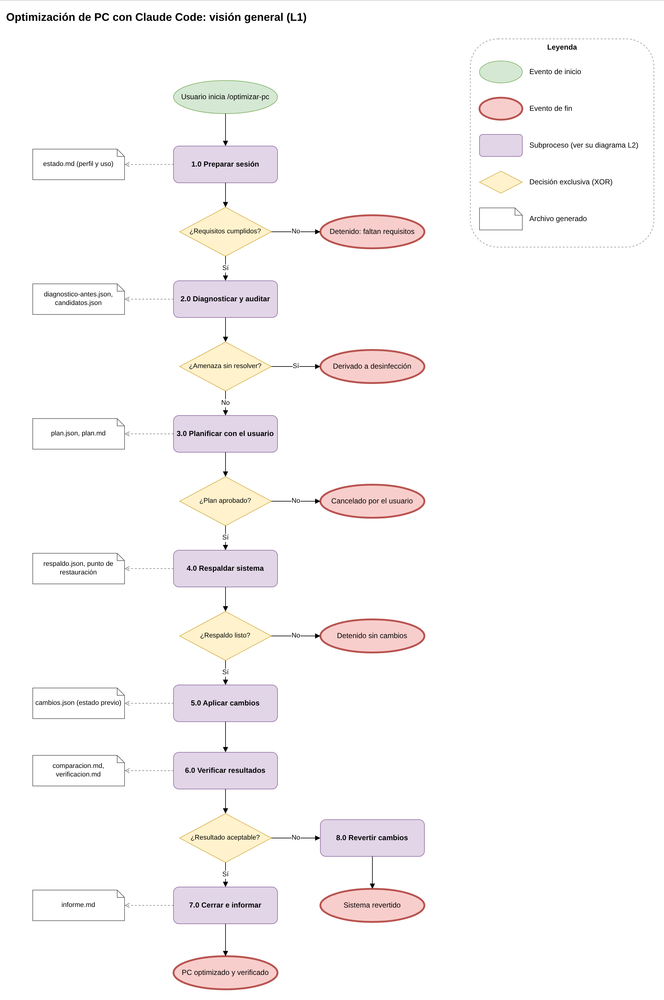

Versión Mermaid

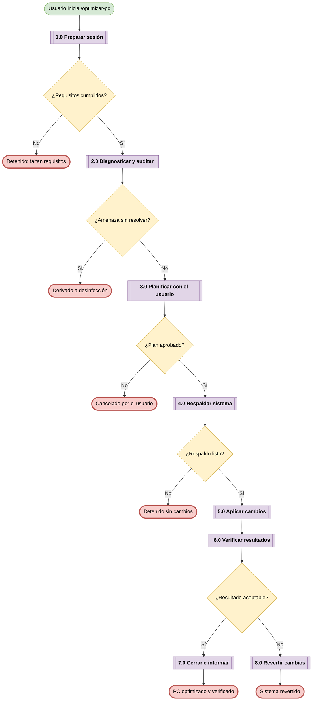

## 1.0 Preparar sesión

| # | Quién | Qué pasa |
|---|---|---|
| 1 | Orquestador | Verifica que es Windows y que Claude Code corre como administrador. Si no, explica cómo abrirlo bien y termina (*Detenido: faltan requisitos*). |
| 2 | Orquestador | Explica en pocas líneas qué va a pasar. |
| 3 | Usuario | Responde la entrevista: uso principal, perfil (conservador, equilibrado o máximo), tipo de equipo, si usa impresora, clips de Game Bar, Game Pass o búsqueda de Windows; juegos y navegador. |
| 4 | Orquestador | Crea `reportes/<fecha>/estado.md` con las respuestas. Este archivo permite retomar tras reiniciar. |

## 2.0 Diagnosticar y auditar

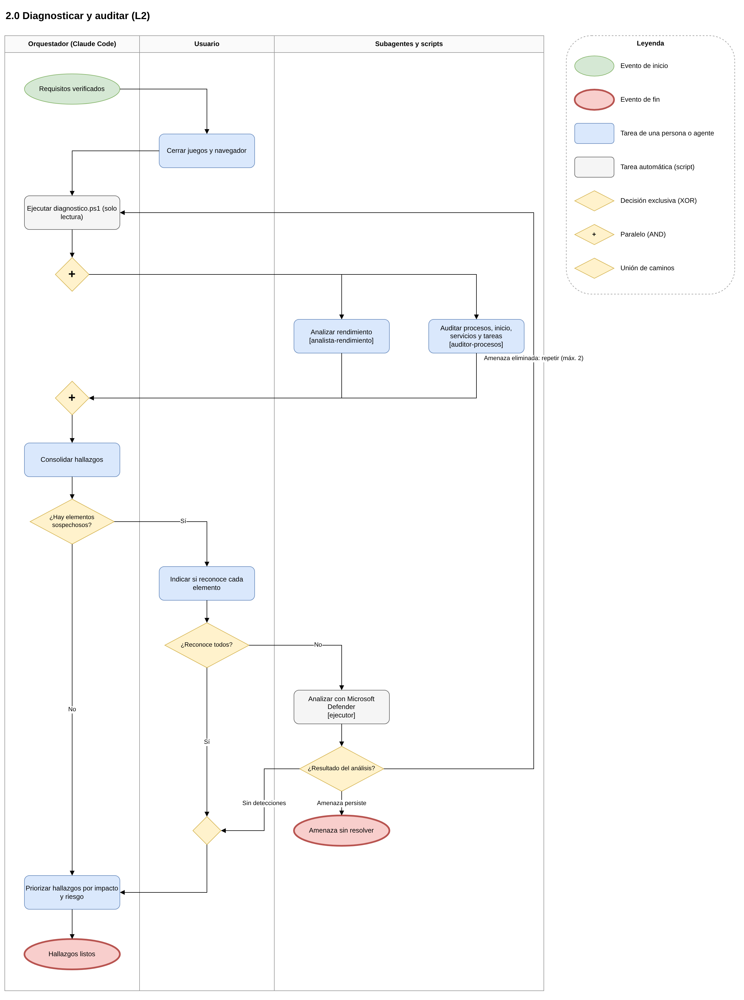

- El diagnóstico es **solo lectura**. Los dos análisis corren **en paralelo** para ahorrar tiempo.
- Un elemento "sospechoso" tiene señales, no pruebas: por eso primero se te pregunta si lo reconoces.
- El análisis de Defender lo corre el `ejecutor` con tu permiso. Si eliminó algo, se repite el diagnóstico (máximo 2 vueltas) para no medir un equipo infectado.

Versión Mermaid

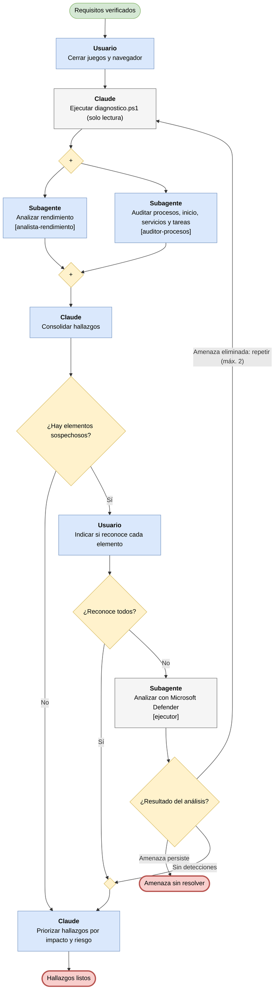

## 3.0 Planificar con el usuario

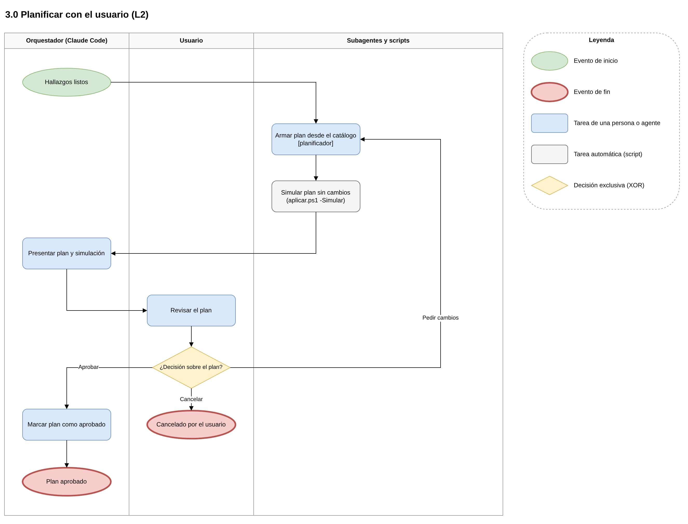

- El `planificador` solo puede usar acciones del catálogo. Antes de mostrarte el plan, lo **simula** (`aplicar.ps1 -Simular`) para descartar lo que no existe en tu equipo o está protegido.
- "Aprobar" incluye aprobar quitando algunas acciones. Solo después de tu "sí" el orquestador marca `"aprobado": true`.

Versión Mermaid

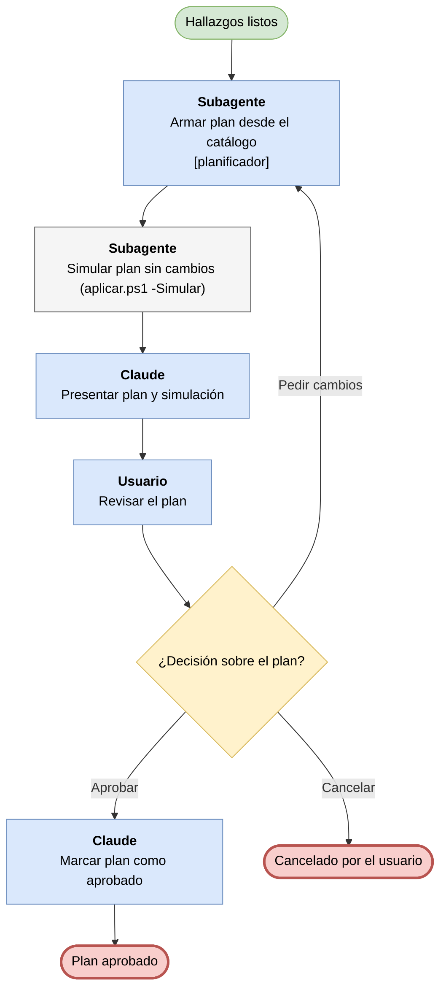

## 4.0 Respaldar sistema

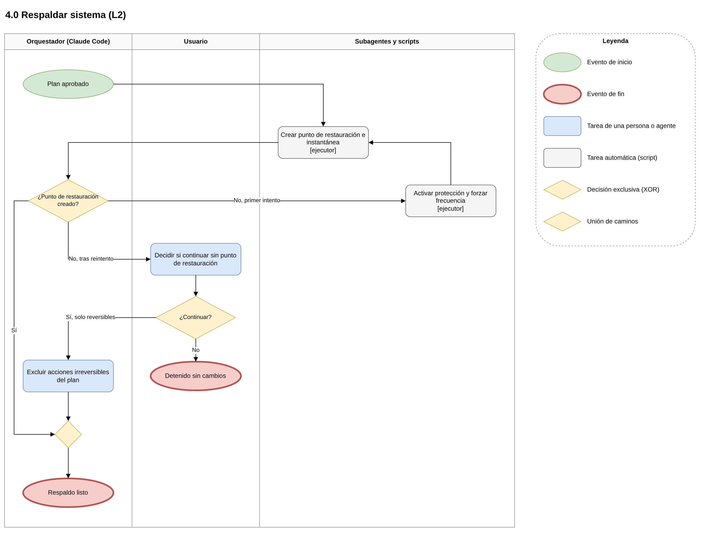

- Windows solo permite un punto de restauración cada 24 h y a veces la Protección del sistema viene apagada: el reintento resuelve ambos casos.
- Sin punto de restauración no se aplica nada irreversible, y solo se sigue si tú lo aceptas.

Versión Mermaid

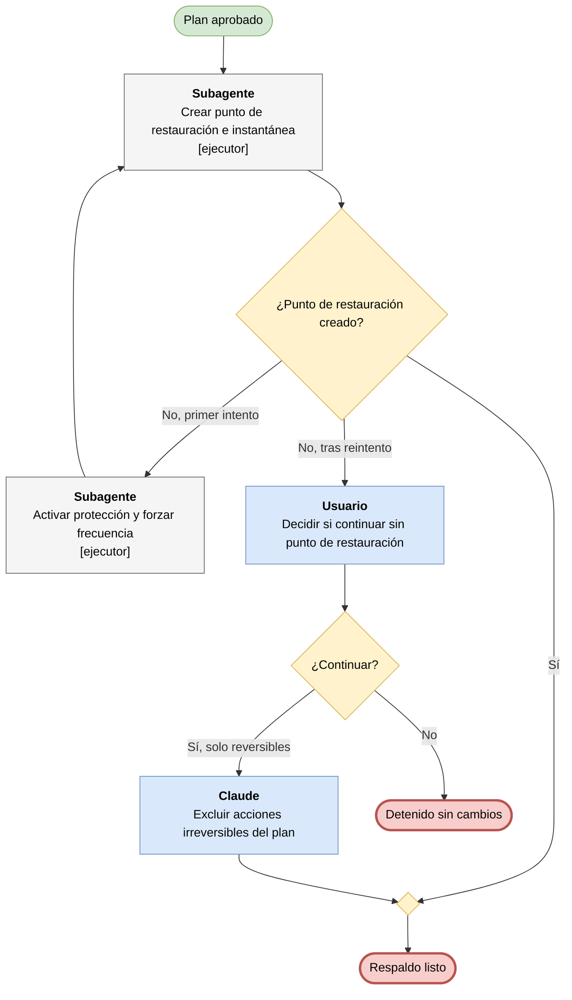

## 5.0 Aplicar cambios

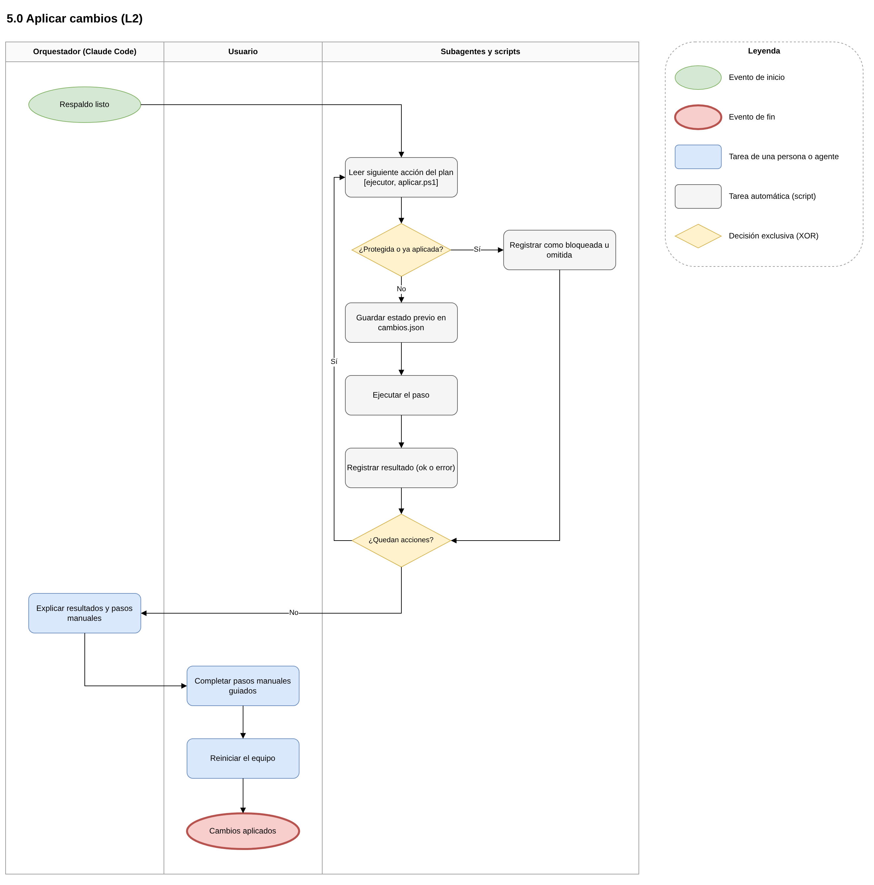

- `aplicar.ps1` guarda el **estado previo** de cada elemento antes de tocarlo: eso es lo que permite revertir con precisión.
- Rechaza cualquier paso sobre elementos protegidos (Defender, Windows Update, firewall, etc.) aunque venga en el plan.
- Al reiniciar se cierra Claude Code. Para seguir: abre la Terminal como administrador en la carpeta del repo y ejecuta `claude --continue`.

Versión Mermaid

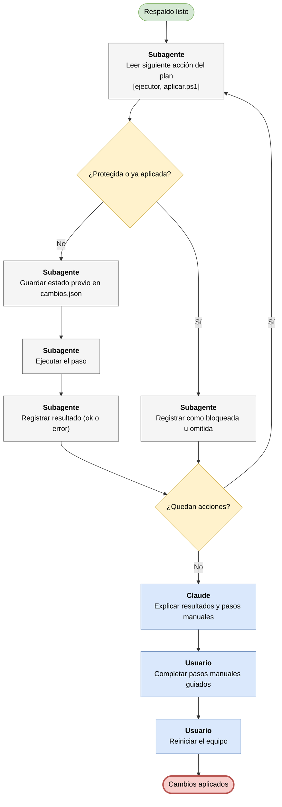

## 6.0 Verificar resultados

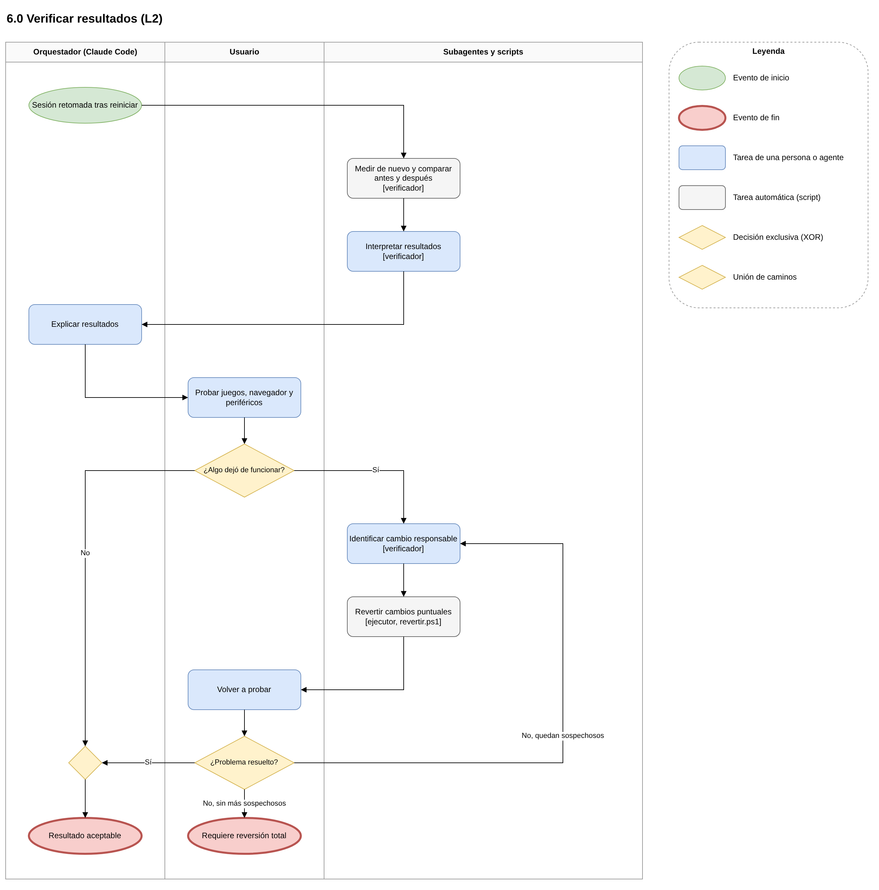

- La medición posterior se hace en las mismas condiciones que la inicial (recién reiniciado, sin juegos ni navegador abiertos).
- Si algo dejó de funcionar, se revierte **solo el cambio sospechoso** y se vuelve a probar. Si no se encuentra la causa, se pasa a la reversión total (8.0).

Versión Mermaid

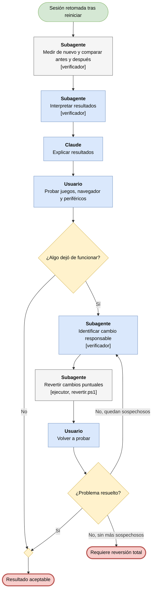

## 7.0 Cerrar e informar

| # | Quién | Qué pasa |
|---|---|---|
| 1 | Orquestador | Escribe `informe.md`: equipo, cuello de botella, cambios aplicados, revertidos y pendientes, tabla antes/después. |
| 2 | Orquestador | Añade recomendaciones de hardware y ajustes dentro de tus juegos y del navegador. |
| 3 | Orquestador | Propone el mantenimiento: reiniciar cada semana, revisar el inicio al instalar programas, repetir `/optimizar-pc` cada 2-3 meses. |
| 4 | Orquestador | Marca `estado.md` como `cerrada`. **Fin: PC optimizado y verificado.** |

## 8.0 Revertir cambios

| # | Quién | Qué pasa |
|---|---|---|
| 1 | Usuario | Confirma que quiere deshacer todo. |
| 2 | `ejecutor` | Ejecuta `revertir.ps1` con todo `cambios.json`, en orden inverso. |
| 3 | Usuario | Reinicia y prueba. |
| 4 | Usuario + Orquestador | Si sigue fallando: restaurar sistema (Win+R > `rstrui` > punto "Antes de optimizar el PC (Claude Code)"). |
| 5 | Orquestador | Marca `estado.md` como `cerrada` (revertido). **Fin: sistema revertido.** |

## Validación del modelo

Los diagramas se generaron desde una sola especificación y pasaron estas comprobaciones automáticas en todos los niveles:

- [x] Un inicio por diagrama y al menos un final; todos los finales son estados reales del proceso.
- [x] Todo nodo es alcanzable desde el inicio y llega a algún final.
- [x] Cada decisión es una pregunta y todas sus ramas están etiquetadas; las ramas son excluyentes y cubren todos los casos.
- [x] Cada rombo paralelo (AND) que abre tiene su rombo de unión.
- [x] Cada ciclo (pedir cambios, reintentar respaldo, repetir diagnóstico, revertir otro sospechoso) tiene una salida.
- [x] Cada tarea empieza con un verbo.
- [x] Sin aristas cruzadas en draw.io; ruteo ortogonal; leyenda en cada pestaña.
